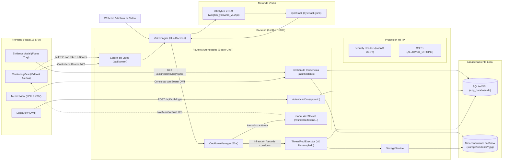

# EPP SafetyVision

Sistema web local para la supervisión y detección en tiempo real de Equipos de Protección Personal (EPP) en obra mediante visión por computador (YOLO).

[](https://www.python.org/)
[](https://fastapi.tiangolo.com/)
[](https://react.dev/)
[](https://vitejs.dev/)
[](https://docs.ultralytics.com/)
[](https://www.sqlite.org/)
[](#)

---

## Descripción General

**EPP SafetyVision** es una solución de monitoreo diseñada para apoyar al supervisor de seguridad y salud en el trabajo en obras civiles e industriales. El sistema analiza transmisiones de video en vivo (cámaras web físicas locales o archivos de video grabados) e identifica mediante modelos de detección de objetos la presencia o ausencia reglamentaria de tres implementos clave de seguridad: **casco**, **chaleco** y **guantes**.

El sistema opera de forma **100 % local (On-Premise)**, procesando la inferencia en el equipo anfitrión sin transmitir datos visuales a servicios externos, garantizando la confidencialidad y privacidad de la información capturada en faena.

### Características Clave

- **Detección en tiempo real:** Clasificación simultánea de conformidad (`casco`, `chaleco`, `guantes`) e infracciones (`sin_casco`, `sin_chaleco`, `sin_guantes`) mediante cajas de detección por elemento de EPP asociadas al trabajador mediante seguimiento espacial.
- **Seguimiento con ByteTrack:** Algoritmo de tracking multiobjeto espacial (`bytetrack.yaml`) que asigna un `track_id` consistente a cada persona en escena, tolerando oclusiones breves y cruces de operarios.
- **Supresión inteligente de alertas (Cooldown 60 s):** Cada infracción detectada sobre un identificador de seguimiento (`track_id`) activa una ventana de gracia de 60 segundos por tipo de omisión. Durante este intervalo, la persona se mantiene en monitoreo continuo con recuadros visuales sin generar registros duplicados ni saturar las alertas sonoras.
- **I/O Asíncrono desacoplado (ThreadPoolExecutor):** La extracción de fotogramas de evidencia en JPEG (calidad 90) y su inserción en SQLite se despachan a un pool de hilos secundario, evitando bloqueos en el hilo de captura y manteniendo una tasa de cuadros constante (FPS).
- **Evidencia fotográfica y persistencia:** Cada incidente confirmado genera una fotografía anotada con banner de telemetría protegida bajo almacenamiento local autenticado y un registro estructurado en SQLite en modo WAL (*Write-Ahead Logging*).
- **Alertas en tiempo real autenticadas:** Despacho instantáneo de infracciones al navegador mediante WebSockets autenticados (`?token=...`), acompañado de una alarma industrial sintetizada a través de la Web Audio API.
- **Telemetría e indicadores (KPIs):** Conteo de infracciones por turno, historial acumulado, tipos de omisión más frecuentes y distribución temporal continua en las últimas 24 horas reales con exportación a formato CSV.

---

## Arquitectura del Sistema



---

## Requisitos Previos

- **Sistema Operativo:** Windows 10 o Windows 11 (64-bit), optimizado para captura directa de video con `cv2.CAP_DSHOW`.
- **Python:** Versión 3.12 (probado y validado en Python 3.12.6).
- **Node.js:** Versión 18 o superior con npm (requerido para compilar o ejecutar el frontend en modo desarrollo).
- **Cámara web (opcional):** Dispositivo USB o cámara integrada compatible con los índices de captura 0 a 3. En ausencia de cámara física, se pueden subir y procesar archivos de video locales.
- **Aceleración por GPU (opcional):** Tarjeta gráfica NVIDIA compatible con CUDA soportada por PyTorch. En caso de no contar con GPU, el motor ejecuta la inferencia en CPU de manera automática.

---

## Instalación y Ejecución

Todos los pasos siguientes se ejecutan desde una terminal de **PowerShell** en la raíz del proyecto (`d:\PROYECTO-YOLO\PPE_PROYECTO-1\eppDetect`).

### 1. Configurar el Entorno de Backend

Crear un entorno virtual de Python e instalar las dependencias fijadas del proyecto:

```powershell
# Crear el entorno virtual con Python 3.12
python -m venv .venv

# Activar el entorno virtual en PowerShell
.venv\Scripts\Activate.ps1

# Instalar dependencias exactas desde requirements.txt
pip install -r requirements.txt
```

#### Ejecución de Pruebas Unitarias Automatizadas

El proyecto cuenta con una suite integral de 20 pruebas unitarias automatizadas que validan la seguridad, el gestor de cooldown, los esquemas Pydantic y los controles de autenticación en la API:

```powershell
# Ejecutar la suite de pruebas unitarias (20 tests en backend/tests)
& .venv\Scripts\python.exe -m unittest discover backend/tests
```

### 2. Variables de Entorno y Configuración

El proyecto incluye un archivo plantilla [.env.example](.env.example) en la raíz. Puede crear su archivo `.env` para personalizar la clave de firmado criptográfico y los orígenes autorizados:

```powershell
# Opcional: Copiar plantilla de variables de entorno
Copy-Item .env.example .env
```

> [!NOTE]
> Si no se define un archivo `.env` o si la variable `SECRET_KEY` se omite, el sistema genera automáticamente una clave criptográfica aleatoria segura en memoria al arrancar mediante `secrets.token_urlsafe(32)`.

### 3. Inicializar la Base de Datos

Antes del primer arranque, ejecute el script de inicialización para crear el esquema en SQLite y registrar los usuarios iniciales:

```powershell
& .venv\Scripts\python.exe backend\init_db.py
```

El script [backend/init_db.py](backend/init_db.py) crea las tablas necesarias y genera dos usuarios semilla para los roles de **supervisor** y **administrador**. Las direcciones de correo electrónico y contraseñas correspondientes están definidas directamente dentro de dicho script.

> [!CAUTION]
> Revise y actualice las contraseñas predeterminadas dentro de [backend/init_db.py](backend/init_db.py) antes de ejecutar el script en cualquier entorno compartido o de uso real. Nunca mantenga contraseñas por defecto en producción ni las exponga en texto plano.

### 4. Iniciar el Servidor Backend

Inicie el servicio de FastAPI mediante el intérprete del entorno virtual:

```powershell
& .venv\Scripts\python.exe backend\main.py
```

- **Servicio Backend:** `http://127.0.0.1:8000`
- **Documentación Interactiva (Swagger UI):** `http://127.0.0.1:8000/docs`

### 5. Poner en Marcha el Frontend

Dispone de dos alternativas para ejecutar la interfaz de usuario:

#### Opción A: Modo Desarrollo (Vite Dev Server)
Permite recarga rápida en caliente (*Hot Module Replacement*) durante el desarrollo.

```powershell
cd frontend
npm install
npm run dev
```

La interfaz estará disponible en **`http://localhost:3000`**. Las peticiones hacia `/api`, `/ws` y `/static` se reenvían automáticamente al backend en el puerto `8000` mediante el proxy configurado en [frontend/vite.config.js](frontend/vite.config.js).

#### Opción B: Modo Compilado (Servido directamente por FastAPI)
Compila la aplicación React en archivos estáticos para que el propio backend los despache:

```powershell
cd frontend
npm run build
```

Una vez generada la carpeta `frontend/dist`, reinicie o mantenga activo el backend (`backend/main.py`). La interfaz de usuario completa se servirá directamente en **`http://127.0.0.1:8000`**.

---

## Flujo de Uso

1. **Inicio de Sesión:** Ingrese sus credenciales en la vista de acceso. El sistema valida el usuario contra SQLite aplicando protección contra ataques de temporización y emite un token Bearer JWT de sesión.
2. **Selección de Fuente de Video:** En la vista de **Monitoreo**, elija el origen de captura deseado:
   - Cámaras web físicas locales (escaneadas automáticamente en los índices 0 al 3 con `cv2.CAP_DSHOW`).
   - Carga de un archivo de video local (`.mp4`, `.avi`, `.mkv`, `.mov`) mediante el formulario integrado con validación de tamaño (hasta 200 MB), extensión y nombre seguro UUID.
3. **Inicio de Monitoreo:** Haga clic en **Iniciar Monitoreo**. El motor iniciará el hilo secundario de inferencia y tracking ByteTrack, desplegando el flujo MJPEG autenticado con recuadros verdes (EPP en regla) y rojos (infracciones activas con su ID de seguimiento).
4. **Atención de Alertas:** Al confirmarse una infracción fuera de cooldown, el sistema reproduce una alerta sonora industrial y presenta la tarjeta del incidente en el panel lateral con la evidencia fotográfica en alta resolución dentro del modal interactivo con atrapamiento de foco (*Focus Trap*).
5. **Auditoría y Métricas:** En la pestaña **Métricas**, consulte los indicadores operativos del turno, analice los patrones de incumplimiento mediante gráficos de distribución temporal en 24 horas continuas y descargue el historial de incidencias en formato CSV.

---

## Configuración

Los parámetros operativos del sistema se centralizan en la clase `Settings` dentro de [backend/app/core/config.py](backend/app/core/config.py) y pueden anularse mediante variables de entorno (consulte [.env.example](.env.example)):

| Parámetro | Valor por Defecto | Origen / Variable | Descripción |
|---|---|---|---|
| `SECRET_KEY` | Clave aleatoria `secrets.token_urlsafe(32)` | `os.getenv("SECRET_KEY")` | Clave criptográfica para la firma HS256 de los tokens JWT de sesión. Configurable vía `.env`. |
| `ALLOWED_ORIGINS` | `localhost:3000, 127.0.0.1:3000, localhost:8000, 127.0.0.1:8000` | `os.getenv("ALLOWED_ORIGINS")` | Lista estricta de orígenes autorizados para el middleware CORS y validación de WebSockets. |
| `MODEL_PATH` | `weights_yolov26s_v1.2.pt` | `PROJECT_ROOT / "weights_yolov26s_v1.2.pt"` | Archivo de pesos del modelo YOLO activo (*ignorado en Git vía `.gitignore` para optimizar el repo*). |
| `CONF_THRESHOLD` | `0.50` | `os.getenv("CONF_THRESHOLD")` | Umbral mínimo de confianza para considerar válida una detección de objeto. |
| `INCIDENT_COOLDOWN_SECONDS` | `60.0` | `os.getenv("INCIDENT_COOLDOWN_SECONDS")` | Ventana de supresión de alertas en segundos por tupla `(track_id, tipo_infraccion)`. |
| `ACCESS_TOKEN_EXPIRE_MINUTES` | `720` (12 horas) | `os.getenv("ACCESS_TOKEN_EXPIRE_MINUTES")` | Período de vigencia de los tokens de autenticación JWT. |
| `MAX_UPLOAD_SIZE_BYTES` | `209715200` (200 MB) | Constante en `Settings` | Límite máximo permitido para la subida de videos locales de prueba. |
| `ALLOWED_VIDEO_EXTENSIONS` | `{".mp4", ".avi", ".mkv", ".mov"}` | Constante en `Settings` | Conjunto de extensiones de archivo de video permitidas para análisis. |

---

## Estructura del Proyecto

```text
eppDetect/
├── .env.example             # Plantilla de variables de entorno y seguridad
├── .gitignore               # Reglas de exclusión (ignora .pt, .venv, bases de datos y dist)
├── README.md                # Documentación principal del repositorio
├── requirements.txt         # Dependencias exactas de Python del proyecto completo
├── ruff.toml                # Configuración de linter y formateador Ruff
├── weights_yolov26s_v1.2.pt # Pesos del modelo YOLO activo (desindexado de Git, preservado local)
├── weights_yolov26m_v1.3.pt # Pesos alternativos medianos (desindexado de Git, preservado local)
├── backend/
│   ├── app/
│   │   ├── api/             # Enrutadores REST, WebSocket y dependencias (auth, stream, incidents, ws, deps)
│   │   ├── core/            # Configuración, seguridad (bcrypt/JWT), botsort_fast.yaml y zona horaria
│   │   ├── domain/          # Modelos de datos SQLAlchemy (User, Incident)
│   │   ├── schemas/         # Modelos Pydantic para validación rigurosa de requests/responses
│   │   ├── services/        # VideoEngine, CooldownManager, StorageService, WSManager
│   │   └── database.py      # Conexión a SQLite y configuración de motor WAL
│   ├── storage/             # Evidencias fotográficas (.jpg) y videos subidos (en runtime)
│   ├── tests/               # Suite de 30 pruebas unitarias automatizadas con unittest
│   │   ├── test_api_auth.py # Pruebas de protección de rutas y cabeceras de seguridad
│   │   ├── test_cooldown.py # Pruebas unitarias de CooldownManager y supresión 60 s
│   │   ├── test_schemas.py  # Validación de modelos Pydantic y serialización
│   │   ├── test_security.py # Pruebas de hashing bcrypt, firma y expiración JWT
│   │   └── test_video_engine_lifecycle.py # Pruebas de ciclo de vida del motor de video y cámara
│   ├── consultar_bd.py      # Utilidad CLI para inspeccionar usuarios e incidentes en SQLite
│   ├── init_db.py           # Script para crear tablas y sembrar usuarios iniciales
│   └── main.py              # Punto de entrada FastAPI, ciclo de vida, middlewares y montaje de SPA
├── frontend/
│   ├── src/
│   │   ├── components/      # Componentes de UI accesibles (Navbar, Select, DatePicker, EvidenceModal)
│   │   ├── context/         # AuthContext (token, usuario activo y estado de alarma sonora)
│   │   ├── services/        # Clientes fetch de API y sintetizador de audio (Web Audio API)
│   │   ├── utils/           # Utilidades centralizadas de formateo (formatters.js)
│   │   ├── views/           # Vistas principales (LoginView, MonitoringView, MetricsView)
│   │   └── App.jsx          # Enrutador de estado y controlador de conexión WebSocket
│   ├── package.json         # Dependencias de frontend (React 18, Vite 5, Recharts, Lucide)
│   └── vite.config.js       # Configuración de Vite y proxies inversos de desarrollo
└── docs/                    # Informes técnicos exhaustivos y auditorías
    ├── ARQUITECTURA.md      # Resumen ejecutivo, diagramas de flujo y mapa del proyecto
    ├── ANALISIS_BACKEND.md  # Análisis en profundidad del backend, modelos, tracking y servicios
    ├── ANALISIS_FRONTEND.md # Evaluación de componentes React, usabilidad y accesibilidad WCAG
    └── ANALISIS_SEGURIDAD.md# Auditoría de seguridad de aplicaciones y plan de mitigación
```

---

## Referencia Rápida de API

A continuación se resumen los endpoints provistos por el backend FastAPI:

| Método | Endpoint | Autenticación | Descripción |
|---|---|:---:|---|
| `POST` | `/api/auth/login` | No | Inicio de sesión con credenciales; emite token Bearer JWT. |
| `GET` | `/api/auth/me` | **Sí (Bearer JWT)** | Retorna la identidad y rol del usuario autenticado actual. |
| `GET` | `/api/stream/cameras` | **Sí (Bearer JWT)** | Escanea y lista los índices de cámaras web físicas locales (0 a 3). |
| `POST` | `/api/stream/start` | **Sí (Bearer JWT)** | Inicia el procesamiento e inferencia con validación síncrona de fuente de captura. |
| `POST` | `/api/stream/stop` | **Sí (Bearer JWT)** | Detiene el hilo de procesamiento de forma segura mediante `threading.Event`. |
| `GET` | `/api/stream/status` | **Sí (Bearer JWT)** | Consulta telemetría operativa en vivo (FPS, estado, tracks y conteo de infracciones). |
| `POST` | `/api/stream/upload_video` | **Sí (Bearer JWT)** | Carga de video local (validación `.mp4`, `.avi`, `.mkv`, `.mov`, nombres UUID, límite 200 MB y verificación de contención). |
| `GET` | `/api/stream/video_feed` | **Sí (Query `?token=...` o Bearer JWT)** | Transmisión continua en formato MJPEG asíncrono con cabeceras anti-caché. |
| `GET` | `/api/incidents` | **Sí (Bearer JWT)** | Consulta paginada del historial de incidencias con filtros de fecha y tipo. |
| `GET` | `/api/incidents/{incident_id}/frame` | **Sí (Bearer JWT o Query `?token=...`)** | Entrega controlada de la evidencia fotográfica JPEG almacenada en disco. |
| `GET` | `/api/incidents/metrics/summary` | **Sí (Bearer JWT)** | Agregados estadísticos y distribución horaria continua en las últimas 24 horas reales. |
| `WS` | `/ws/alerts` | **Sí (Query `?token=...`)** | Canal WebSocket autenticado para recepción de alertas en tiempo real con validación de origen. |

---

## Endurecimiento de Seguridad Implementado

> [!IMPORTANT]
> **Mitigaciones de Seguridad Implementadas:**  
> En cumplimiento del plan de aseguramiento documentado en [docs/ANALISIS_SEGURIDAD.md](docs/ANALISIS_SEGURIDAD.md), el sistema cuenta con los siguientes controles activos:
> 
> 1. **Autenticación Integral en toda la Superficie de la API:** Todas las rutas de control (`/api/stream/*`), gestión de datos (`/api/incidents/*`), entrega de evidencias visuales, flujo de video MJPEG y el canal WebSocket (`/ws/alerts`) exigen autenticación obligatoria mediante tokens Bearer JWT firmados con algoritmo HS256.
> 2. **Prevención Estricta de Path Traversal y Ejecución Remota:** La carga de videos locales (`POST /api/stream/upload_video`) restringe las extensiones a una lista blanca (`.mp4`, `.avi`, `.mkv`, `.mov`), renombra los archivos con identificadores únicos UUIDv4 seguros, impone un límite estricto de 200 MB por archivo y valida la contención dentro del directorio autorizado mediante `Path.resolve()` e `is_relative_to()`. Se retiró la exposición estática desprotegida de la carpeta de evidencias (`/static/incidents`).
> 3. **Gestión de Secretos Desacoplada:** La clave secreta de firmado criptográfico se lee de variables de entorno (`SECRET_KEY`). Si no se provee, se genera un secreto criptográfico aleatorio seguro en memoria (`secrets.token_urlsafe(32)`). Se provee la plantilla [.env.example](.env.example).
> 4. **Protección contra Timing Attacks en Login:** La autenticación de usuarios simula el cálculo de hash bcrypt incluso cuando el usuario solicitado no existe en la base de datos, impidiendo la enumeración de cuentas mediante análisis de tiempos de respuesta.
> 5. **Inyección de Cabeceras HTTP de Seguridad:** Se aplica middleware global que inyecta `X-Content-Type-Options: nosniff`, `X-Frame-Options: DENY` y `Referrer-Policy: strict-origin-when-cross-origin` en todas las respuestas del servidor.
> 6. **Restricción CORS y Validación de Origen en WebSockets:** Se restringe la comunicación únicamente a los dominios autorizados en `ALLOWED_ORIGINS` y se verifica la cabecera `Origin` en cada negociación de socket.

> [!CAUTION]
> Recuerde actualizar las contraseñas predeterminadas del script [backend/init_db.py](backend/init_db.py) antes de inicializar la base de datos en un entorno productivo o compartido.

---

## Documentación Técnica

Para un análisis técnico exhaustivo de cada capa y componente del sistema, consulte los informes técnicos detallados en la carpeta `docs/`:

- [docs/ARQUITECTURA.md](docs/ARQUITECTURA.md): Resumen de arquitectura global, ciclo de vida del fotograma, sincronización y guía técnica.
- [docs/ANALISIS_BACKEND.md](docs/ANALISIS_BACKEND.md): Desglose técnico de FastAPI, motor de inferencia YOLO, tracking ByteTrack, persistencia SQLite WAL e I/O desacoplado con ThreadPoolExecutor.
- [docs/ANALISIS_FRONTEND.md](docs/ANALISIS_FRONTEND.md): Análisis de vistas y componentes React, consumo de WebSockets, alarmas sintetizadas y auditoría de accesibilidad WCAG 2.2 AA.
- [docs/ANALISIS_SEGURIDAD.md](docs/ANALISIS_SEGURIDAD.md): Auditoría completa de seguridad de aplicaciones (OWASP Top 10), matriz de riesgos y mitigaciones implementadas.
