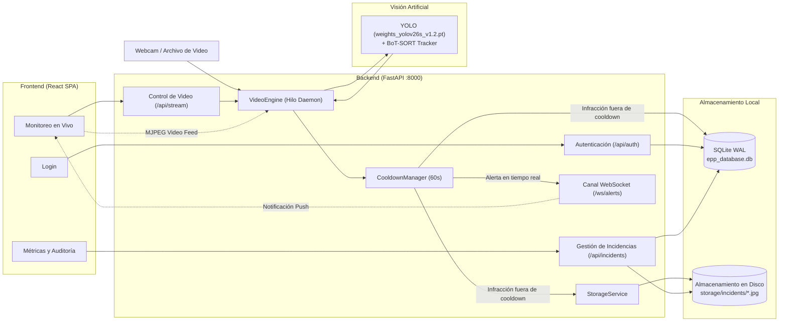

# EPP SafetyVision

Sistema web local para la supervisión y detección en tiempo real de Equipos de Protección Personal (EPP) en obra mediante visión por computador (YOLO).

[](https://www.python.org/)
[](https://fastapi.tiangolo.com/)
[](https://react.dev/)
[](https://vitejs.dev/)
[](https://docs.ultralytics.com/)
[](https://www.sqlite.org/)

---

## Descripción General

**EPP SafetyVision** es una solución de monitoreo diseñada para apoyar al supervisor de seguridad y salud en el trabajo en obras civiles e industriales. El sistema analiza transmisiones de video en vivo (cámara web local o archivos de video previamente grabados) e identifica mediante modelos de detección de objetos la presencia o ausencia reglamentaria de tres implementos clave de seguridad: **casco**, **chaleco** y **guantes**.

El sistema opera de forma **100 % local (On-Premise)**, procesando la inferencia en el equipo anfitrión sin transmitir datos visuales a servicios externos, asegurando la privacidad de la información capturada en faena.

### Características Clave

- **Detección en tiempo real:** Clasificación simultánea de conformidad (`casco`, `chaleco`, `guantes`) e infracciones (`sin_casco`, `sin_chaleco`, `sin_guantes`) mediante cajas de detección por elemento de EPP (cada caja recibe un `track_id` del tracker).
- **Supresión inteligente de alertas (Cooldown 60 s):** Cada infracción detectada sobre un identificador de seguimiento (`track_id`) activa una ventana de gracia de 60 segundos. Durante este intervalo, la persona se mantiene en monitoreo silencioso sin registrar duplicados en la base de datos ni saturar los avisos sonoros.
- **Evidencia fotográfica y persistencia:** Cada incidente confirmado genera un fotograma anotado en JPEG (calidad 90) almacenado en disco y un registro estructurado en una base de datos SQLite en modo WAL (*Write-Ahead Logging*).
- **Alertas en tiempo real:** Comunicación instantánea entre el motor de visión y el navegador mediante WebSockets, acompañada de una alarma industrial sintetizada a través de la Web Audio API.
- **Telemetría e indicadores (KPIs):** Conteo de infracciones por turno, historial acumulado, tipos de omisión más frecuentes y distribución horaria en 24 horas con opción de exportación a CSV.

---

## Arquitectura del Sistema



---

## Requisitos Previos

- **Sistema Operativo:** Windows 10 o Windows 11 (64-bit), optimizado para captura directa de video con `cv2.CAP_DSHOW`.
- **Python:** Versión 3.12 (probado y validado en Python 3.12.6).
- **Node.js:** Versión 18 o superior con npm (requerido para compilar o ejecutar el frontend en modo desarrollo).
- **Cámara web (opcional):** Dispositivo USB o cámara integrada compatible con los índices de captura 0 a 3. En ausencia de cámara física, se pueden subir archivos de video desde la interfaz web.
- **Aceleración por GPU (opcional):** Tarjeta gráfica NVIDIA compatible con CUDA soportada por PyTorch. En caso de no contar con GPU, el motor ejecuta la inferencia en CPU.

---

## Instalación y Ejecución

Todos los pasos siguientes se ejecutan desde una terminal de **PowerShell** en la raíz del proyecto (`d:\PROYECTO-YOLO\PPE_PROYECTO-1\eppDetect`).

### 1. Configurar el Entorno de Backend

Crear un entorno virtual de Python e instalar las dependencias necesarias:

```powershell
# Crear el entorno virtual con Python 3.12
python -m venv .venv

# Activar el entorno virtual
.venv\Scripts\Activate.ps1

# Instalar las librerías requeridas
pip install fastapi uvicorn ultralytics opencv-python sqlalchemy bcrypt pyjwt python-multipart lap
```

> [!NOTE]
> El repositorio actualmente no incluye un archivo `requirements.txt`. El comando anterior instala el conjunto exacto de dependencias identificado y verificado durante el análisis del backend.

### 2. Inicializar la Base de Datos

Antes del primer arranque, ejecute el script de inicialización para crear el esquema en SQLite y registrar los usuarios iniciales:

```powershell
& .venv\Scripts\python.exe backend\init_db.py
```

El script [backend/init_db.py](backend/init_db.py) crea las tablas necesarias y genera dos usuarios semilla para los roles de **supervisor** y **administrador**. Las direcciones de correo electrónico y contraseñas correspondientes están definidas directamente dentro de dicho script.

> [!CAUTION]
> Revise y actualice las credenciales predeterminadas dentro de [backend/init_db.py](backend/init_db.py) antes de ejecutar el script en cualquier entorno compartido o de uso real. Nunca mantenga contraseñas por defecto en producción ni las exponga en texto plano.

### 3. Iniciar el Servidor Backend

Inicie el servicio de FastAPI mediante el intérprete del entorno virtual:

```powershell
& .venv\Scripts\python.exe backend\main.py
```

- **Servicio Backend:** `http://127.0.0.1:8000`
- **Documentación Interactiva (Swagger UI):** `http://127.0.0.1:8000/docs`

### 4. Poner en Marcha el Frontend

Dispone de dos alternativas para ejecutar la interfaz de usuario:

#### Opción A: Modo Desarrollo (Vite Dev Server)
Permite recarga rápida en caliente (*Hot Module Replacement*) durante el desarrollo.

```powershell
cd frontend
npm install
npm run dev
```

La interfaz estará disponible en **`http://localhost:3000`**. Las peticiones hacia `/api`, `/ws` y `/static` se reenvían automáticamente al backend en el puerto `8000` mediante el proxy configurado en [frontend/vite.config.js](frontend/vite.config.js).

#### Opción B: Modo Compilado (Servido directamente por FastAPI)
Compila la aplicación React en archivos estáticos para que el propio backend los despache:

```powershell
cd frontend
npm run build
```

Una vez generada la carpeta `frontend/dist`, reinicie o mantenga activo el backend (`backend/main.py`). La interfaz de usuario completa se servirá directamente en **`http://127.0.0.1:8000`**.

---

## Flujo de Uso

1. **Inicio de Sesión:** Ingrese sus credenciales en la vista de acceso. El sistema valida el usuario contra la base de datos local y genera un token JWT de sesión.
2. **Selección de Fuente de Video:** En la vista de **Monitoreo**, elija el origen de captura:
   - Cámaras web locales disponibles (escaneadas automáticamente en los índices 0 al 3).
   - Carga de un archivo de video local (`.mp4`, `.avi`) mediante el formulario integrado.
3. **Inicio de Monitoreo:** Haga clic en **Iniciar Monitoreo**. El motor iniciará el hilo de inferencia y tracking continuo, desplegando el flujo MJPEG anotado con recuadros verdes (EPP en regla) y rojos (infracciones activas con su ID de seguimiento).
4. **Atención de Alertas:** Al confirmarse una infracción fuera de cooldown, el sistema reproduce una alerta sonora y presenta la tarjeta del incidente en el panel lateral con la evidencia fotográfica en alta resolución.
5. **Auditoría y Métricas:** En la pestaña **Métricas**, consulte las estadísticas operativas del turno, analice los patrones de incumplimiento mediante gráficos interactivos y descargue el historial de incidencias en formato CSV.

---

## Configuración

Los parámetros operativos del sistema se centralizan en la clase `Settings` dentro de [backend/app/core/config.py](backend/app/core/config.py):

| Parámetro | Valor por Defecto | Descripción |
|---|---|---|
| `MODEL_PATH` | `weights_yolov26s_v1.2.pt` | Archivo de pesos del modelo YOLO en uso (existe también [weights_yolov26m_v1.3.pt](weights_yolov26m_v1.3.pt) como alternativa sin uso activo). |
| `CONF_THRESHOLD` | `0.50` | Umbral mínimo de confianza para considerar válida una detección de objeto. |
| `INCIDENT_COOLDOWN_SECONDS` | `60.0` | Ventana de supresión de alertas en segundos por combinación de `(track_id, tipo_infraccion)`. |
| `ACCESS_TOKEN_EXPIRE_MINUTES` | `720` (12 horas) | Período de vigencia del token de autenticación JWT. |
| `SECRET_KEY` | *Valor hardcodeado* | Cadena secreta utilizada para la firma criptográfica HS256 de los tokens JWT. |

> [!NOTE]
> La versión actual define estas variables de manera fija en código. Si requiere modificar umbrales o rutas, edite directamente los valores en [backend/app/core/config.py](backend/app/core/config.py).

---

## Estructura del Proyecto

```text
eppDetect/
├── backend/
│   ├── app/
│   │   ├── api/             # Enrutadores REST y WebSocket (auth, stream, incidents, ws)
│   │   ├── core/            # Configuración general, seguridad (bcrypt/JWT) y zona horaria
│   │   ├── domain/          # Modelos de datos SQLAlchemy (User, Incident)
│   │   ├── schemas/         # Modelos Pydantic para validación de requests/responses
│   │   ├── services/        # VideoEngine, CooldownManager, StorageService, WSManager
│   │   └── database.py      # Conexión a SQLite y configuración de motor WAL
│   ├── storage/             # Evidencias fotográficas (.jpg) y videos subidos (en runtime)
│   ├── consultar_bd.py      # Utilidad CLI para inspeccionar usuarios e incidentes en SQLite
│   ├── init_db.py           # Script para crear tablas y sembrar usuarios iniciales
│   └── main.py              # Punto de entrada de FastAPI, ciclo de vida y montaje de SPA
├── frontend/
│   ├── src/
│   │   ├── components/      # Componentes transversales de UI (Navbar, etc.)
│   │   ├── context/         # AuthContext (token, usuario activo y estado del sonido)
│   │   ├── services/        # Clientes fetch de API y sintetizador de audio (Web Audio API)
│   │   ├── views/           # Vistas principales (LoginView, MonitoringView, MetricsView)
│   │   └── App.jsx          # Enrutador de estado y controlador de conexión WebSocket
│   ├── package.json         # Dependencias de frontend (React 18, Vite 5, Recharts, Lucide)
│   └── vite.config.js       # Configuración de Vite y proxies inversos de desarrollo
├── docs/                    # Informes técnicos exhaustivos y auditorías
│   ├── ARQUITECTURA.md      # Resumen ejecutivo, diagramas de flujo y mapa del proyecto
│   ├── ANALISIS_BACKEND.md  # Análisis en profundidad del backend, modelos y servicios
│   ├── ANALISIS_FRONTEND.md # Evaluación de componentes React, usabilidad y accesibilidad
│   └── ANALISIS_SEGURIDAD.md# Auditoría de seguridad de aplicaciones (OWASP Top 10)
├── weights_yolov26s_v1.2.pt # Pesos del modelo YOLO activo en el sistema
├── weights_yolov26m_v1.3.pt # Pesos de modelo mediano alternativo (sin uso actual)
├── predictions.py           # Script independiente de prueba rápida del modelo con webcam
└── README.md                # Documentación principal del repositorio
```

---

## Referencia Rápida de API

A continuación se resumen los endpoints provistos por el backend FastAPI:

| Método | Endpoint | Autenticación | Descripción |
|---|---|:---:|---|
| `POST` | `/api/auth/login` | No | Inicio de sesión con credenciales; emite token Bearer JWT. |
| `GET` | `/api/auth/me` | **Sí (Bearer JWT)** | Retorna la identidad y rol del usuario autenticado actual. |
| `GET` | `/api/stream/cameras` | No | Lista los índices de cámaras web físicas detectadas en el equipo. |
| `POST` | `/api/stream/start` | No | Inicia el procesamiento de inferencia para una cámara o video. |
| `POST` | `/api/stream/stop` | No | Detiene el hilo de procesamiento y libera los recursos de captura. |
| `GET` | `/api/stream/status` | No | Consulta métricas operativas en vivo (FPS, estado, tracks, infracciones). |
| `POST` | `/api/stream/upload_video` | No | Sube un archivo de video local para su posterior análisis. |
| `GET` | `/api/stream/video_feed` | No | Flujo de video anotado continuo transmitido mediante protocolo MJPEG. |
| `GET` | `/api/incidents` | No | Consulta paginada del historial de incidencias con filtros de fecha y tipo. |
| `GET` | `/api/incidents/{incident_id}/frame` | No | Entrega la imagen JPEG almacenada como evidencia de una infracción. |
| `GET` | `/api/incidents/metrics/summary` | No | Retorna agregaciones cuantitativas y distribución horaria de infracciones. |
| `WS` | `/ws/alerts` | No | Canal WebSocket bidireccional para el despacho de alertas en tiempo real. |

---

## Estado de Seguridad

> [!WARNING]
> **Prototipo para Entorno Local de Pruebas:**  
> Este proyecto fue concebido y estructurado como una prueba de concepto operativa de ejecución local. Antes de considerar un despliegue en redes de obra o escenarios de producción, considere los siguientes factores analizados en las auditorías técnicas:
> - **Falta de autenticación en endpoints operativos:** Con la excepción de `GET /api/auth/me`, la totalidad de las rutas de control (`/api/stream/*`), consulta de datos (`/api/incidents/*`) y el socket de eventos (`/ws/alerts`) no requieren token ni validación de roles.
> - **Gestión de credenciales y firmas:** La clave `SECRET_KEY` se encuentra estática en el código fuente versionado, y las contraseñas iniciales de prueba están predefinidas en el script de arranque.
> - **Carga y almacenamiento de archivos:** La subida de videos almacena archivos en disco sin una sanitización exhaustiva de nombres de archivo ni validación rigurosa de tipos de contenido.
> - **Política CORS permisiva:** Está habilitada para cualquier origen (`*`) con el propósito de facilitar la comunicación entre puertos en desarrollo local.
> 
> Para revisar el detalle exhaustivo de riesgos y el plan de mitigación recomendado, consulte [docs/ANALISIS_SEGURIDAD.md](docs/ANALISIS_SEGURIDAD.md).

---

## Documentación Técnica

Para un análisis técnico profundo de cada componente del sistema, consulte los informes de arquitectura y auditoría disponibles en la carpeta `docs/`:

- [docs/ARQUITECTURA.md](docs/ARQUITECTURA.md): Resumen de arquitectura global, diagramas de secuencia del frame a la alerta y guía para desarrolladores.
- [docs/ANALISIS_BACKEND.md](docs/ANALISIS_BACKEND.md): Desglose exhaustivo del servicio FastAPI, ciclo de vida, motor de inferencia, tracking y almacenamiento.
- [docs/ANALISIS_FRONTEND.md](docs/ANALISIS_FRONTEND.md): Análisis de vistas y componentes React, consumo de WebSockets, alarmas sonoras y estado de accesibilidad.
- [docs/ANALISIS_SEGURIDAD.md](docs/ANALISIS_SEGURIDAD.md): Auditoría completa de seguridad de aplicaciones basada en OWASP Top 10 y modelado de amenazas STRIDE.
